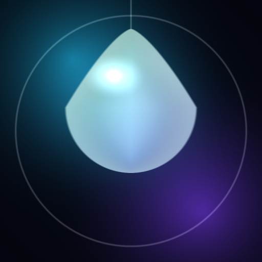

<div align="center">



# LiquidClick

**Автокликер в стиле liquid glass: клики, свайпы, зажатия, вставка текста,
сценарии с распознаванием текста на экране и генератор мировых имён.**

[](https://github.com/creepyside11/Auto-Clicker/actions/workflows/android.yml)
[](https://github.com/creepyside11/Auto-Clicker/releases/latest)

</div>

---

## Установка

1. Скачайте `LiquidClick-*.apk` со страницы [Releases](../../releases/latest).
2. Разрешите установку из неизвестного источника.
3. Откройте приложение и включите:
   - **Настройки → Служба доступности → LiquidClick** — без неё нет нажатий;
   - **Ещё → Захват экрана → Разрешить** — нужно для распознавания текста.

## Возможности

| Раздел | Что умеет |
| --- | --- |
| **Меню** | Боковая стеклянная панель слева: разделы и выбор сценария для запуска (кнопка «СЦЕНАРИЙ» внизу). |
| **Кликер** | Тап, зажатие и свайп по выбранной точке. Интервал 10 мс – 3 с, счётчик кликов, «дрожание» координат, бесконечный режим. |
| **Сценарии** | Два способа создания. **Списком** — цепочки шагов: тап, зажатие, свайп, вставка текста, пауза, «Назад», «Домой» и **условие** по тексту в области. **Кнопками на экране** — нажимаете «✚ Кнопка», на экране появляется стеклянная капля-шаг, её можно перетащить в нужную точку; тап по капле открывает редактор шага, крестик удаляет, «◉» скрывает все. Циклы и бесконечный запуск. |
| **Наблюдение** | Области экрана, которые проверяются постоянно (или только во время сценария). Появился текст — тап, запуск сценария или остановка. |
| **Имена** | Генератор редких имён и фамилий из 9 регионов мира: СНГ, Европа, Азия, Ближний Восток, Африка, Латинская Америка, США, Индия, Океания. Имя и фамилия выводятся отдельно, без цифр; ник — транслит. Можно добавить своё слово или цифры к нику. |
| **Плавающая панель** | Стеклянная панель поверх любых приложений: старт/стоп, выбор точки, выбор области. |

### Как собрать сценарий — способ 1 (списком)

1. **Сценарии → ＋ Создать**.
2. **＋ Добавить шаг** → «Тап» → «Указать точку на экране» (приложение свернётся, выберите точку в нужном приложении).
3. Добавьте шаг **«Условие по тексту»** → выделите область → впишите ожидаемый текст → включите «Нажать при совпадении» и укажите точку.
4. **Готово** → ▶ Запуск.

### Как собрать сценарий — способ 2 (кнопками на экране)

1. Выберите сценарий в боковом меню (кнопка «СЦЕНАРИЙ»).
2. Нажмите **✚ Кнопка** — на экране появится стеклянная капля с номером шага.
3. Перетащите каплю туда, где нужно нажимать. Позиция сразу сохраняется.
4. Тап по капле — открыть редактор шага (тип действия, текст, длительность).
5. **✕** на капле — удалить шаг, **◉** в плавающей панели — скрыть/показать все кнопки.
6. ▶ в плавающей панели — запустить выбранный сценарий.

## Технические детали

- Kotlin + Jetpack Compose (Material 3), собственный glass-дизайн: размытые градиентные пятна, полупрозрачные карточки, световые границы.
- Нажатия — `AccessibilityService.dispatchGesture`, ввод текста — `ACTION_SET_TEXT` с резервной вставкой из буфера.
- Распознавание текста — ML Kit Text Recognition (полностью офлайн, модель в APK).
- Захват экрана — `MediaProjection` + `ImageReader`, кадр обрезается по области и распознаётся.
- Хранение — `SharedPreferences` + Gson, всё локально.

## Сборка

APK собирается автоматически в GitHub Actions при каждом пуше в `main`
и публикуется в Releases. Локально:

```bash
gradle :app:assembleRelease
```

## Приватность

Приложение не имеет доступа в интернет: разрешение `INTERNET` не запрашивается.
Все данные и распознанный текст остаются на устройстве.
